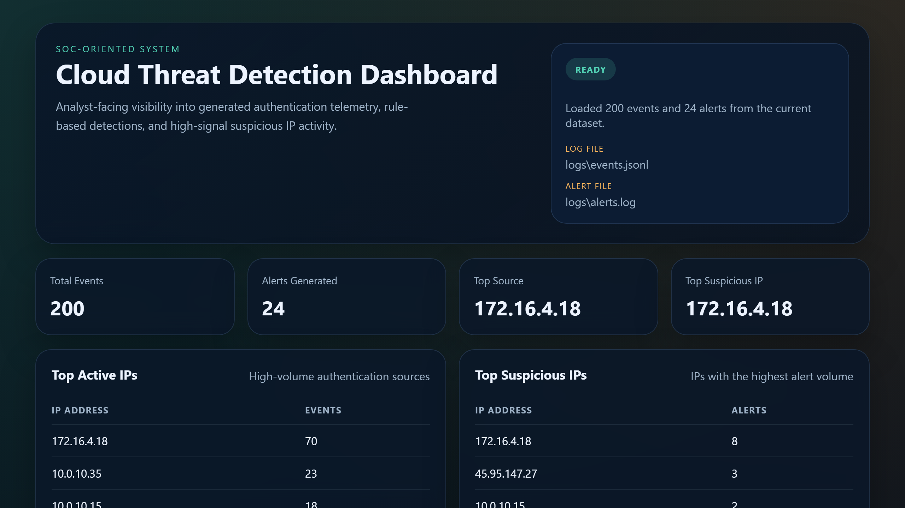
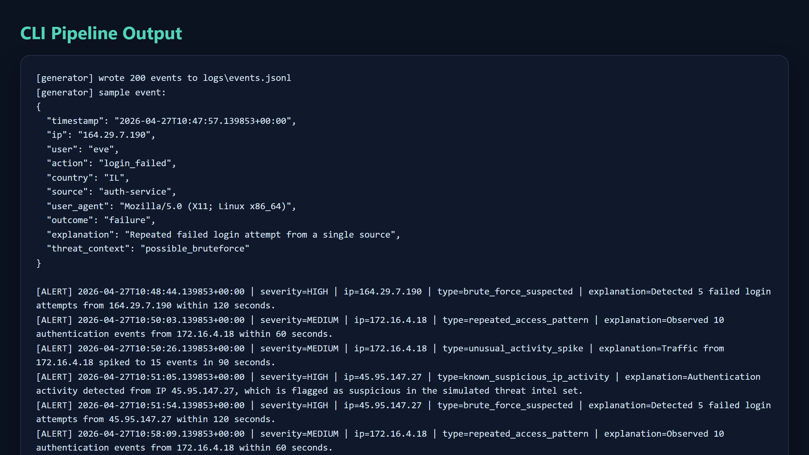
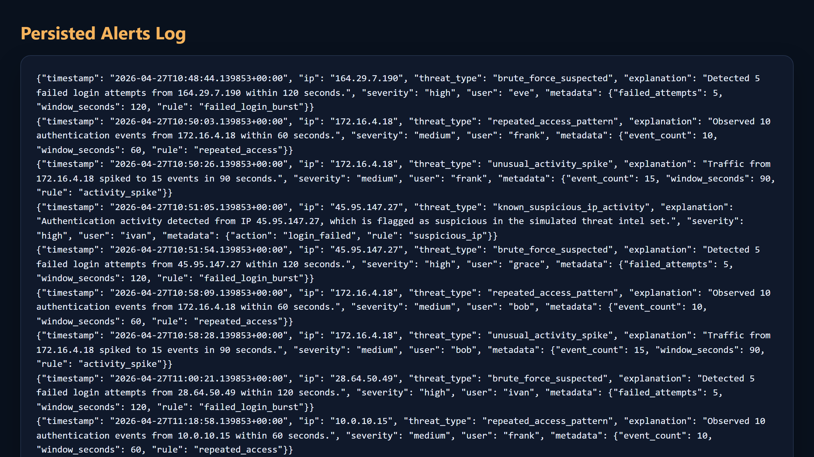

# AegisSOC: Cloud Security Telemetry & Threat Detection Engine

[](https://github.com/isitanand/aegis-threat-detection-pipeline/actions/workflows/ci.yml)

A lightweight, enterprise-grade Security Operations Center (SOC) telemetry and incident detection engine engineered in Python. AegisSOC ingests multi-source authentication telemetry, evaluates behavioral indicators against configurable sliding-window heuristics, triggers incident alerts with contextual scoring, and delivers both command-line incident triage and interactive web dashboard visualizations.

Designed for modern cloud security operations, this system emphasizes modular detection workflows, deterministic rule evaluations, robust alert logging, and fully containerized Docker execution.

## Core Capabilities

- Generates authentication-style events in JSONL format
- Detects brute-force behavior, repeated access patterns, short-window activity spikes, and activity from simulated suspicious IPs
- Emits structured alerts to the console and `logs/alerts.log`
- Provides CLI and Flask dashboard summaries
- Supports optional webhook forwarding
- Runs locally or through Docker Compose
- Includes automated tests and GitHub Actions CI

## Architecture

```text
+-------------------+       +-------------------+       +-------------------+
|   Log Generator   | ----> |   Log Analyzer    | ----> |   Alert Manager   |
| JSONL auth events |       | Rule-based engine |       | Console + file    |
+-------------------+       +-------------------+       +-------------------+
                                      |
                                      v
                            +-------------------+
                            |  CLI / Web Views  |
                            | Metrics + alerts  |
                            +-------------------+
```

The detection logic is separated into discrete rules so new detections can be added without rewriting the entire pipeline.

## Detection Rules

| Detection | Trigger |
|---|---|
| `brute_force_suspected` | Failed login threshold exceeded within a short time window |
| `repeated_access_pattern` | High authentication-event volume from one IP |
| `unusual_activity_spike` | Sharp activity increase within a rolling window |
| `known_suspicious_ip_activity` | Event originates from the simulated threat-intelligence list |

Default thresholds:

- Failed logins: `5` in `120` seconds
- Repeated access: `10` events in `60` seconds
- Activity spike: `15` events in `90` seconds

## Example Event

```json
{
  "timestamp": "2026-04-16T11:41:15.792790+00:00",
  "ip": "45.95.147.27",
  "user": "ivan",
  "action": "login_failed",
  "country": "CN",
  "source": "auth-service",
  "user_agent": "Mozilla/5.0 (X11; Linux x86_64)",
  "outcome": "failure",
  "explanation": "Authentication attempt from an IP marked as suspicious",
  "threat_context": "known_bad_ip"
}
```

## Example Alert

```json
{
  "timestamp": "2026-04-16T11:42:04.792790+00:00",
  "ip": "45.95.147.27",
  "threat_type": "brute_force_suspected",
  "explanation": "Detected 5 failed login attempts from 45.95.147.27 within 120 seconds.",
  "severity": "high",
  "user": "grace",
  "metadata": {
    "failed_attempts": 5,
    "window_seconds": 120,
    "rule": "failed_login_burst"
  }
}
```

## Quick Start

### Requirements

- Python 3.12
- `pip`

Install dependencies:

```bash
pip install -r requirements.txt
```

Run the full pipeline:

```bash
python src/main.py run \
  --count 200 \
  --output logs/events.jsonl \
  --alerts-output logs/alerts.log \
  --seed 42
```

Generate events only:

```bash
python src/main.py generate \
  --count 200 \
  --output logs/events.jsonl \
  --seed 42
```

Analyze an existing event file:

```bash
python src/main.py analyze \
  --input logs/events.jsonl \
  --alerts-output logs/alerts.log
```

## Web Dashboard

Launch the Flask dashboard:

```bash
python src/main.py dashboard \
  --input logs/events.jsonl \
  --alerts-output logs/alerts.log
```

Open:

```text
http://127.0.0.1:5000
```

The dashboard displays:

- total events processed
- total alerts generated
- top active IPs
- top suspicious IPs
- alert-type breakdown
- recent persisted alerts

## Docker

Build and run with Docker Compose:

```bash
docker compose -f docker/docker-compose.yml up --build
```

Generated events and alerts are written to the local `logs/` directory through a mounted volume.

## Alert Forwarding

Alerts can be forwarded as JSON to a webhook endpoint.

```bash
python src/main.py run --webhook-url https://example.com/security-alerts
```

Or through an environment variable:

```bash
export SOC_ALERT_WEBHOOK_URL=https://example.com/security-alerts
python src/main.py analyze
```

An example configuration is available in `.env.example`.

## Testing

Run the automated test suite:

```bash
python -m unittest discover -s tests -v
```

The tests cover:

- event generation and required fields
- end-to-end detection of the core alert types
- alert persistence in valid JSON format
- malformed-input handling
- webhook delivery behavior
- dashboard rendering

## Screenshots

### Web Dashboard



### CLI Output



### Alerts Log



## Project Structure

```text
.
|-- docker/
|   |-- Dockerfile
|   `-- docker-compose.yml
|-- docs/
|-- logs/
|-- src/
|   |-- alerts.py
|   |-- analyzer.py
|   |-- detector_rules.py
|   |-- log_generator.py
|   |-- main.py
|   `-- web_dashboard.py
|-- static/
|-- templates/
|-- tests/
|-- .env.example
|-- Makefile
|-- requirements.txt
`-- run_pipeline.sh
```

## Supporting Documentation

- [Architecture Overview](docs/architecture.md)
- [Detection Rules Reference](docs/detection-rules.md)
- [Operations Runbook](docs/operations-runbook.md)
- [Sample Incident Report](docs/sample-incident-report.md)
- [Changelog](CHANGELOG.md)

## Technology Stack

- Python 3.12
- Flask
- JSONL structured logging
- Rule-based detection logic
- Docker and Docker Compose
- GitHub Actions
- Linux-compatible command flow

## Future Improvements

- ingest events from CloudWatch, syslog, or Kafka
- persist telemetry in PostgreSQL or Elasticsearch
- enrich suspicious IPs through external threat-intelligence sources
- route alerts to Slack, email, or an incident-management platform

## License

Released under the MIT License. See `LICENSE`.
